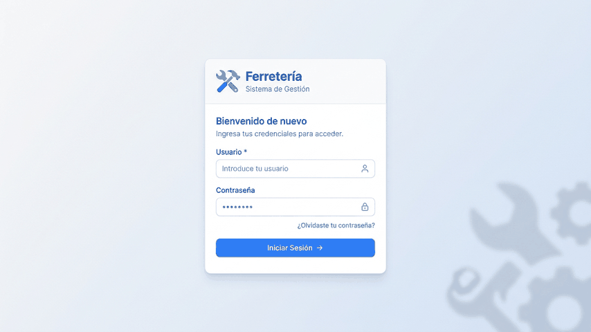
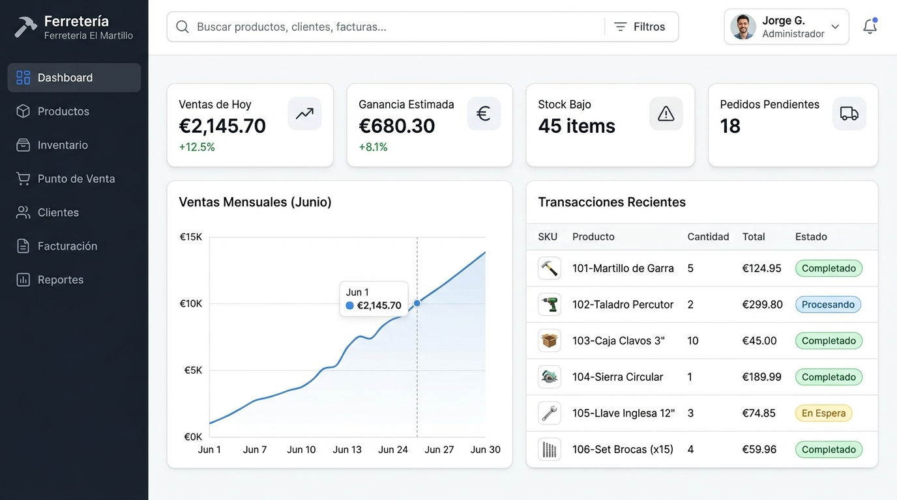
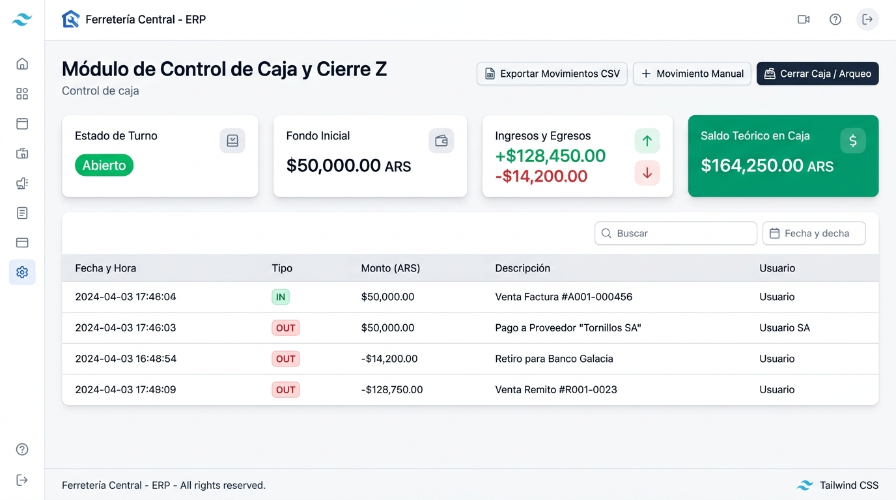
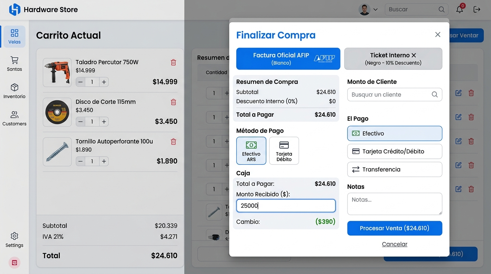
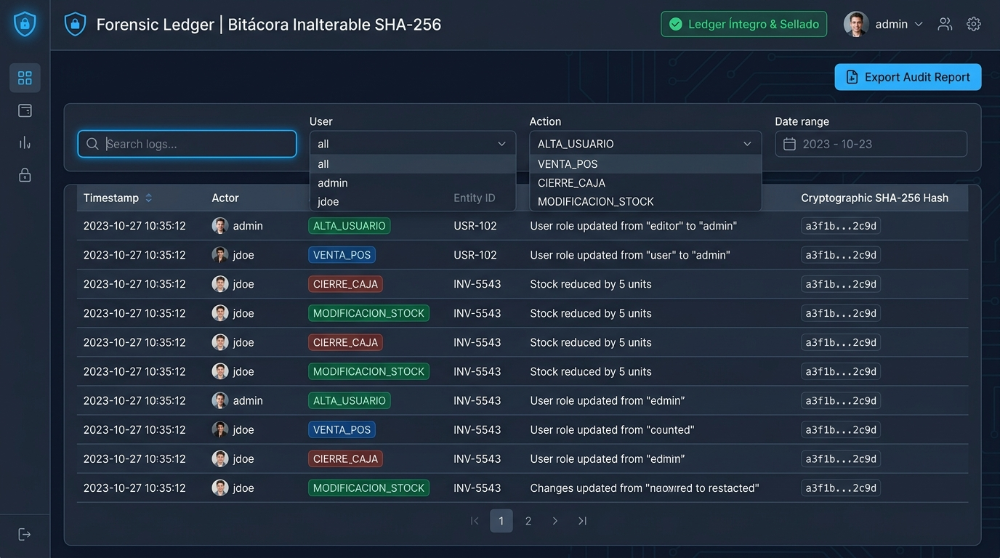
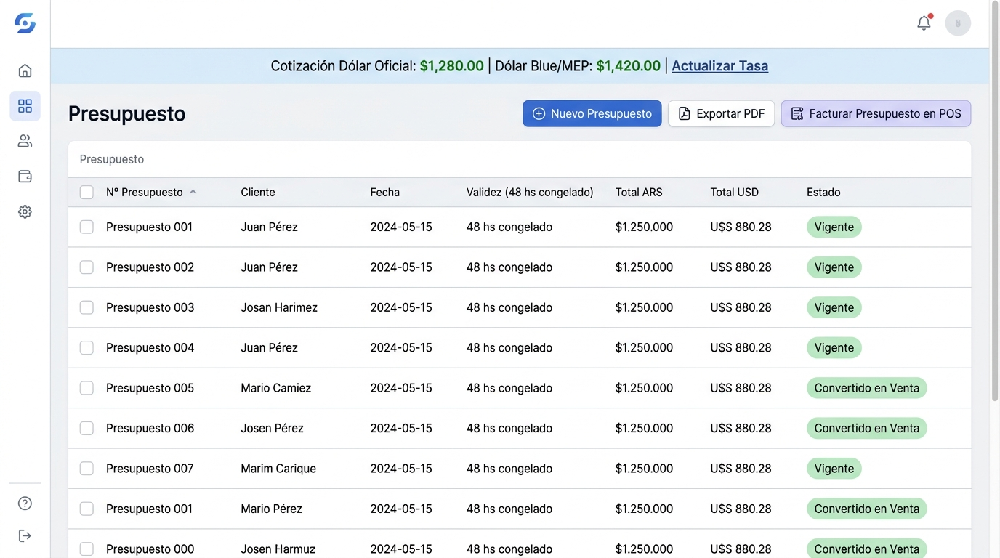

# 🛠️ GestionQuincaillerie — ERP & Point de Vente (POS) pour Quincaillerie et Matériaux

[](https://www.typescriptlang.org/)
[](https://react.dev/)
[](https://vitejs.dev/)
[](https://nestjs.com/)
[](https://tailwindcss.com/)
[](https://www.postgresql.org/)
[](https://www.prisma.io/)
[](https://redis.io/)
[](https://www.docker.com/)
[](https://podman.io/)
[](https://vitest.dev/)

[](https://www.w3.org/WAI/standards-guidelines/wcag/)
[](https://developer.mozilla.org/es/docs/Web/API/Web_Speech_API)
[](https://owasp.org/)

> **Système Intégré de Gestion Commerciale, Contrôle de Stock Multi-Entrepôts, Facturation Fiscale Duale AFIP, Terminal Point de Vente (POS) Haute Vélocité et Synchronisation Omnicanale pour Quincailleries, Dépôts et Négoces de Matériaux de Construction.**  
> Dépôt officiel : [https://github.com/luchoxiii/GestionQuincaillerie](https://github.com/luchoxiii/GestionQuincaillerie)

---

## 📑 Table des Matières

1. [📸 Démonstration Visuelle](#-démonstration-visuelle)
2. [⚡ Guide Complet d'Installation et de Déploiement](#-guide-complet-dinstallation-et-de-déploiement)
   - [🖥️ Mode 1 : Installation Locale Bare-Metal (Sans Docker / Offline-First)](#mode-1--installation-locale-bare-metal-sans-docker--offline-first)
     - [1.1. Mode Autonome Offline-First (Frontend Seul / Persistance Locale)](#11-mode-autonome-offline-first-frontend-seul--persistance-locale)
     - [1.2. Mode Full-Stack Bare-Metal (Frontend + Backend NestJS + PostgreSQL Local)](#12-mode-full-stack-bare-metal-frontend--backend-nestjs--postgresql-local)
   - [🐳 Mode 2 : Déploiement avec Docker & Docker Compose](#mode-2--déploiement-avec-docker--docker-compose)
   - [🦭 Mode 3 : Déploiement avec Podman & Podman Compose (Rootless & Entreprise)](#mode-3--déploiement-avec-podman--podman-compose-rootless--entreprise)
3. [🏛️ Modules Fonctionnels du Système](#️-modules-fonctionnels-du-système)
   - [🛒 1. Terminal de Comptoir & Point de Vente (POS)](#1-terminal-de-comptoir--point-de-vente-pos)
   - [🏛️ 2. Facturation Duale & Régime Fiscal](#2-facturation-duale--régime-fiscal)
   - [📦 3. Catalogue, Stock Multi-Entrepôts & Achats](#3-catalogue-stock-multi-entrepôts--achats)
   - [👥 4. CRM, Intelligence Client & Churn Scoring 360°](#4-crm-intelligence-client--churn-scoring-360)
   - [🎟️ 5. Bons de Fidélité & Devis Bidevise (USD / ARS / EUR)](#5-bons-de-fidélité--devis-bidevise-usd--ars--eur)
   - [🌐 6. Centre E-Commerce & API Mercado Libre](#6-centre-e-commerce--api-mercado-libre)
     - [🟡 Guide de Connexion : API Mercado Libre (MELI)](#guide-meli)
   - [💾 7. Import Massif (Excel / Sheets) & Sauvegarde Google Drive](#7-import-massif-excel--sheets--sauvegarde-google-drive)
     - [☁️ Guide de Configuration : Google Sheets & Google Drive](#guide-google-sheets)
   - [♿ 8. Accessibilité Universelle, Assistant Vocal & WCAG 2.1 (AA/AAA)](#8-accessibilité-universelle-assistant-vocal--wcag-21-aaaa)
   - [⚙️ 9. Panneau de Configuration Graphique](#9-panneau-de-configuration-graphique)
   - [🏪 10. Multi-Magasins & Succursales](#10-multi-magasins--succursales)
   - [🔍 11. Moteur de Recherche en Langage Naturel](#11-moteur-de-recherche-en-langage-naturel)
   - [💵 12. Gestion de Caisse, Suivi en Direct & Clôture Journalière Z](#12-gestion-de-caisse-suivi-en-direct--clôture-journalière-z)
4. [🛡️ Sécurité, Audit & Standards OWASP Top 10](#️-sécurité-audit--standards-owasp-top-10)
   - [Matrice Granulaire de Rôles et Permissions (RBAC)](#matrice-granulaire-de-rôles-et-permissions-rbac)
   - [Conformité de Sécurité OWASP Top 10](#conformité-de-sécurité-owasp-top-10)
   - [Registre Judiciaire Cryptographique SHA-256 Inaltérable](#registre-judiciaire-cryptographique-sha-256-inaltérable)
5. [🧪 Suite de Tests, Stress & Performance (186 Tests)](#-suite-de-tests-stress--performance-186-tests)
6. [⌨️ Raccourcis Clavier du POS & Accessibilité](#️-raccourcis-clavier-du-pos--accessibilité)
7. [🧭 Plan des Routes de l'Application](#-plan-des-routes-de-lapplication)
8. [🏗️ Stack Technologique & Architecture](#️-stack-technologique--architecture)
9. [⚙️ Variables d'Environnement](#️-variables-denvironnement)
10. [📄 Licence](#-licence)

---

## 📸 Démonstration Visuelle

### 🎬 Visite Dynamique du Système (Animation)


---

### 📊 Tableau de Bord Principal (Dashboard)
Indicateurs d'activité en temps réel avec **sélecteur de période** (*Aujourd'hui*, *Hier*, *7 derniers jours*, *Ce mois*, *30 derniers jours*, *Cette année* ou *Plage personnalisée*), graphiques Recharts chiffre d'affaires vs coût, marge brute et alertes de réapprovisionnement.


---

### 💵 Contrôle de Caisse et Clôture Z
Gestion du service de caisse en direct : calcul automatique du **Solde Théorique de Caisse** (`Fond Initial + Encaissements - Décaissements`), journal chronologique des mouvements et détection instantanée des écarts de caisse (excédents ou déficits).


---

### 🛒 Terminal POS avec Facturation Duale & Escompte Espèces
Comptoir haute vélocité : bascule instantanée entre **Facture Officielle (Blanc)** et **Ticket Interne X (Noir)** avec calcul automatique de **l'escompte pour règlement en espèces**, calculatrice de rendu de monnaie et envoi direct de justificatifs par email.


---

### 🛡️ Registre Judiciaire Cryptographique Inaltérable (SHA-256)
Enchaînement d'événements infalsifiable (*blockchain-grade*) : audit rigoureux des utilisateurs, paiements, remises, ajustements d'inventaire et clôtures de caisse scellés par hachage SHA-256.


---

### 📑 Devis Bidevise (USD / ARS / EUR) & Taux de Change en Direct
Établissement de devis avec taux négocié modifiable, gel des tarifs avec durée de validité (24h, 48h, 7j) et conversion en vente comptoir en 1 clic.


---

## ⚡ Guide Complet d'Installation et de Déploiement

Le système propose trois modes de déploiement adaptés à tout environnement :

```
                               ┌─────────────────────────────────┐
                               │   Modes de Déploiement ERP      │
                               └────────────────┬────────────────┘
                                                │
         ┌──────────────────────────────────────┼──────────────────────────────────────┐
         ▼                                      ▼                                      ▼
  🖥️ MODE 1 : Bare-Metal                🐳 MODE 2 : Docker                     🦭 MODE 3 : Podman
  • Sans conteneur                      • docker compose up -d                 • podman-compose up -d
  • Offline-First ou Local              • Conteneurs Docker                    • Rootless & Daemonless
  • Node.js 20+ et pnpm                 • Poste ou Serveur                     • Enterprise / RHEL / Fedora
```

---

<a id="mode-1--installation-locale-bare-metal-sans-docker--offline-first"></a>
### 🖥️ Mode 1 : Installation Locale Bare-Metal (Sans Docker / Offline-First)

Idéal pour les postes de caisse autonomes, les ordinateurs portables sans connexion internet permanente ou les machines aux ressources limitées.

#### Prérequis :
- **Node.js** v20.x LTS ou supérieur ([nodejs.org](https://nodejs.org/))
- **pnpm** v9.x ou supérieur (`npm install -g pnpm`)
- **Git** ([git-scm.com](https://git-scm.com/))

---

#### 1.1. Mode Autonome Offline-First (Frontend Seul / Persistance Locale)
Fonctionne sans base de données externe ni backend actif. Tout l'ERP fonctionne dans le navigateur via `localStorage`.

```bash
# 1. Cloner le dépôt
git clone https://github.com/luchoxiii/GestionQuincaillerie.git
cd GestionQuincaillerie

# 2. Installer les dépendances du monorepo
pnpm install

# 3. Lancer le frontend en mode développement
pnpm --filter @ferreteria/web run dev
```

- **Accès Web :** [http://localhost:5173](http://localhost:5173)
- **Identifiants par défaut :** Utilisateur : `admin` | Mot de passe : `admin123` (ou `admin`)

---

#### 1.2. Mode Full-Stack Bare-Metal (Frontend + Backend NestJS + PostgreSQL Local)

##### 1. Configurer les Services Locaux :
- Installer **PostgreSQL 16**, créer la base `ferreteria_db` et l'utilisateur `ferreteria`.
- Installer **Redis 7** *(facultatif pour le cache)*.

##### 2. Configurer le Fichier d'Environnement :
```bash
cp .env.example .env
```

##### 3. Migrer et Initialiser la Base de Données :
```bash
pnpm --filter @ferreteria/api exec prisma migrate dev --name init
pnpm --filter @ferreteria/api exec ts-node prisma/seed.ts
```

##### 4. Démarrer les Services :
```bash
# Terminal 1 : Backend API (port 4000)
pnpm --filter @ferreteria/api run start:dev

# Terminal 2 : Frontend Web (port 5173)
pnpm --filter @ferreteria/web run dev
```

---

<a id="mode-2--déploiement-avec-docker--docker-compose"></a>
### 🐳 Mode 2 : Déploiement avec Docker & Docker Compose

```bash
# 1. Cloner et installer
git clone https://github.com/luchoxiii/GestionQuincaillerie.git
cd GestionQuincaillerie
pnpm install

# 2. Lancer les conteneurs d'infrastructure
docker compose up -d

# 3. Appliquer les migrations Prisma et initialiser les données
pnpm --filter @ferreteria/api exec prisma migrate dev --name init
pnpm --filter @ferreteria/api exec ts-node prisma/seed.ts

# 4. Démarrer l'application
pnpm --filter @ferreteria/api run start:dev
pnpm --filter @ferreteria/web run dev
```

---

<a id="mode-3--déploiement-avec-podman--podman-compose-rootless--entreprise"></a>
### 🦭 Mode 3 : Déploiement avec Podman & Podman Compose (Rootless & Entreprise)

```bash
# 1. Lancer les conteneurs rootless avec Podman
podman-compose up -d

# 2. Appliquer les migrations
pnpm --filter @ferreteria/api exec prisma migrate dev --name init
pnpm --filter @ferreteria/api exec ts-node prisma/seed.ts

# 3. Démarrer les services
pnpm --filter @ferreteria/api run start:dev
pnpm --filter @ferreteria/web run dev
```

---

## 🏛️ Modules Fonctionnels du Système

### 1. Terminal de Comptoir & Point de Vente (POS)
- **Pilotage 100% Clavier** : Raccourcis universels (`F2` recherche produit, `F3` consultation des prix, `F4` encaissement, `Échap` annuler/vider).
- **Lecteur de Code-Barres USB** : Capture immédiate via le hook `useBarcodeScanner` sans nécessiter de clic préalable dans un champ.
- **Vérificateur Rapide de Prix (`F3`)** : Modal haute visibilité affichant le prix TTC, les facilités de paiement en plusieurs fois et les stocks par entrepôt.
- **Règlements Mixtes & Flexibles** : Espèces avec calculatrice de monnaie, cartes bancaires, virement et comptes clients.
- **Escompte Espèces** : Réduction automatique de 5%, 10%, 15% ou 20% pour règlement comptant en liquide.
- **Envoi de Justificatif par Email** : Expédition automatique du ticket de caisse numérique au client par messagerie.

### 2. Facturation Duale & Régime Fiscal
- **Facture Officielle avec Code CAE (AFIP)** pour professionnels et particuliers déclarés.
- **Ticket Interne X (Noir)** pour délivrance de marchandise en comptoir avec déduction du stock physique sans transmission fiscale.
- **Export du Journal des Ventes** au format CSV normalisé avec séparateur point-virgule (`UTF-8 avec BOM`).

### 3. Catalogue, Stock Multi-Entrepôts & Achats
- Génération automatique de références SKU, codes EAN-13 et marges bénéficiaires.
- Kardex inaltérable (`StockMovement`) traçant chaque entrée, sortie, ajustement et transfert d'entrepôt.
- Gestion des commandes fournisseurs avec intégration automatique des réceptions en stock.

### 4. CRM, Intelligence Client & Churn Scoring 360°
- Segmentation RFM automatique (Récence, Fréquence, Montant).
- Calcul prédictif du risque d'attrition/churn (score de 0 à 100%).
- Actions de fidélisation immédiates : vente avec bon de réduction et prise de contact WhatsApp.
- Export de jeux de données pour modèles de Machine Learning (`exportMLDatasetCsv`).

### 5. Bons de Fidélité & Devis Bidevise
- Création de réductions en pourcentage ou en montant fixe.
- Devis multi-devises en Pesos, Dollars ou Euros avec gel des tarifs pendant 24h, 48h, 7j ou 30j.
- Conversion directe d'un devis en vente au comptoir en 1 clic.

<a id="guide-meli"></a>
### 6. Centre E-Commerce & API Mercado Libre
- Synchronisation continue des commandes, réservation instantanée des stocks et impression d'étiquettes d'expédition au format thermique 10x15 cm.

<a id="guide-google-sheets"></a>
### 7. Import Massif (Excel / Sheets) & Sauvegarde Google Drive
- Importation rapide de fichiers `.xlsx`, `.xls` et `.csv` avec validation visuelle dynamique ligne par ligne.
- Sauvegarde intégrale de l'ERP en format JSON et synchronisation sécurisée sur Google Drive via OAuth2.

### 8. Accessibilité Universelle, Assistant Vocal & WCAG 2.1 (AA/AAA)
- Raccourci global **`Alt + A`**.
- Thème jaune sur noir à contraste ultra-élevé (ratio supérieur à 21:1 conforme WCAG 2.1 AAA).
- Filtres visuels pour daltonisme (Protanopie, Deutéranopie, Tritanopie, Achromatopsie).
- Prise en charge de la dyslexie avec police adaptée et règle de guidage horizontal de lecture.
- Synthèse sonore native via Web Audio API et vocalisation des articles scannés via Web Speech API.

### 9. Panneau de Configuration Graphique
- Gestion des clés API e-commerce, paramètres de messagerie d'entreprise SMTP, Google Drive et formats monétaires régionaux.

### 10. Multi-Magasins & Succursales
- Définition des points de vente fiscaux par établissement et sélecteur de magasin actif dans l'en-tête.

### 11. Moteur de Recherche en Langage Naturel
- Lemmatisation automatique des pluriels/singuliers, insensibilité aux accents et correspondance multi-critères.

### 12. Gestion de Caisse, Suivi en Direct & Clôture Journalière Z
- Enregistrement du fond de roulement initial, calcul du solde théorique et pointage de caisse assisté avec détection des écarts.

---

## 🛡️ Sécurité, Audit & Standards OWASP Top 10

- **A01: Broken Access Control** : Gardiens globaux `JwtAuthGuard` et `PermissionsGuard`.
- **A02: Cryptographic Failures** : Hachage des mots de passe avec `bcryptjs` et masquage des secrets dans les journaux (`[REDACTED]`).
- **A03: Injection** : Requêtes préparées avec Prisma ORM et validation stricte des charges utiles via `ValidationPipe`.
- **A05: Security Misconfiguration** : En-têtes HTTP sécurisés via Fastify Helmet et restrictions strictes CORS.
- **A07: Identification Failures** : Limitation de débit avec Fastify Rate Limit (300 req/min par adresse IP).
- **Registre Judiciaire SHA-256** : Chaînage cryptographique de chaque événement avec l'empreinte du bloc précédent pour une détection immédiate de toute altération.

---

## 🧪 Suite de Tests, Stress & Performance (186 Tests)

L'intégralité des 186 tests unitaires et de résistance est validée à 100% :

```bash
pnpm -r run test
```

| Couche | Outil de Test | Fichiers / Suites | Tests Exécutés | Résultat |
| :--- | :---: | :---: | :---: | :---: |
| **Frontend Web (`apps/web`)** | Vitest 2.1.9 + JSDOM | 20 fichiers | **138 tests** | ✅ **138/138 Réussis** |
| **Backend API (`apps/api`)** | Jest 29 + ts-jest | 8 fichiers | **48 tests** | ✅ **48/48 Réussis** |
| **TOTAL MONOREPO** | Espaces de travail pnpm | **28 fichiers** | **186 tests** | 🏆 **186 Réussis / 0 Échec** |

---

## ⌨️ Raccourcis Clavier du POS & Accessibilité

| Raccourci | Périmètre | Action |
| :--- | :---: | :--- |
| **`F2`** | POS | Activer la zone de recherche rapide d'articles. |
| **`F3`** | Global | Ouvrir le Vérificateur Rapide de Prix et Modalités. |
| **`F4`** | POS | Ouvrir la fenêtre d'encaissement et de choix de paiement. |
| **`Échap`** | POS / Modales | Annuler l'opération, vider le panier ou fermer la fenêtre active. |
| **`Entrée` (Douchette)** | POS | Ajouter directement au panier l'article scanné avec bip de confirmation. |
| **`Ctrl + P`** | POS / Facture | Imprimer le ticket de caisse thermique ou la facture A4. |
| **`Alt + A`** | Global | Ouvrir/Fermer le Centre d'Accessibilité Universelle. |
| **`Alt + S`** | Global | Assistant Vocal : Lecture du titre et du résumé de l'écran affiché. |
| **`Alt + V` / 🔊** | Vérificateur F3 | Énoncer à voix haute le nom, le tarif et la quantité en stock du produit. |

---

## 🏗️ Stack Technologique & Architecture

- **Frontend SPA** : React 18/19, Vite 5.4, Tailwind CSS 3.4, TypeScript.
- **Composants d'Interface** : shadcn/ui, Radix UI, Lucide Icons.
- **Gestion d'État & Données** : Zustand 4.5, TanStack Query 5 (React Query).
- **Visualisation Graphique** : Recharts.
- **Traitement Tableurs** : SheetJS (`xlsx`).
- **Backend API** : NestJS 10, Fastify, TypeScript.
- **Base de Données & ORM** : PostgreSQL 16 avec Prisma ORM 5 (48 modèles relationnels).
- **Cache & Files d'Attente** : Redis 7.
- **Gestionnaire Monorepo** : Espaces de travail pnpm (pnpm Workspaces).

---

## 📄 Licence

Développé pour **GestionQuincaillerie**. Tous droits réservés.
